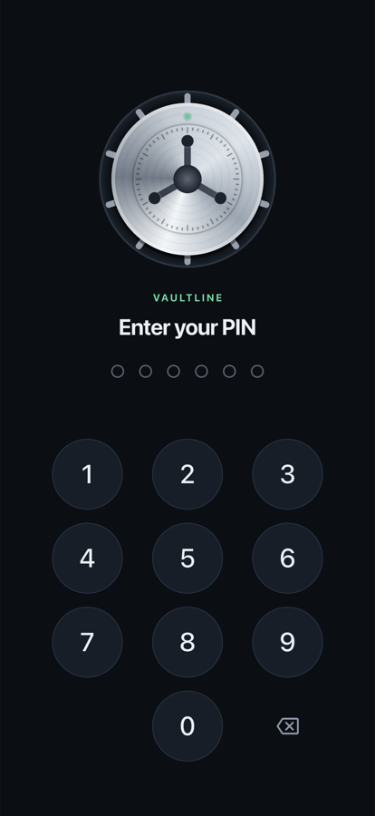
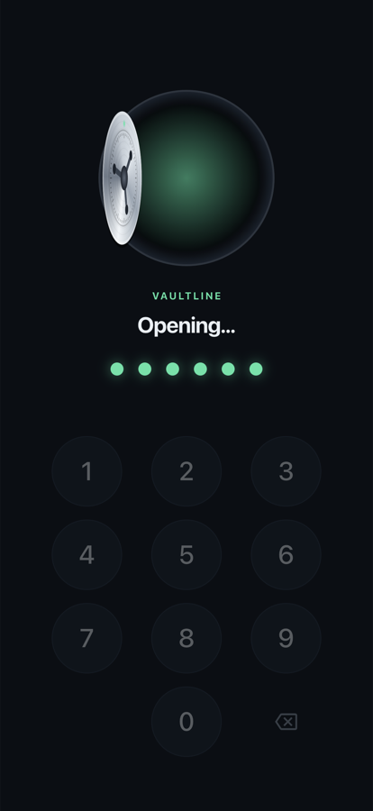
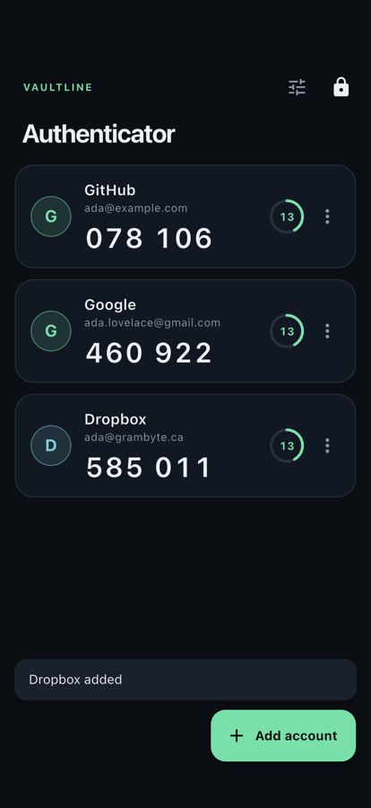
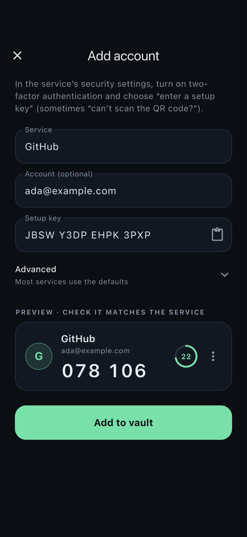

# Vaultline

[](https://github.com/thiskunle/Vaultline/actions/workflows/ci.yml)

A Flutter authenticator and password vault for iOS and Android, built around a 3D vault door. Security comes first; the animation sits on top of it.

<p>
  
  
  
  
</p>

> **Status: early development.** Stages 1–2 (the lock and the authenticator) are complete; QR scanning and the encrypted password vault come next (see the roadmap). Vaultline has not had an independent security audit, so don't keep real secrets in it yet.

## What works today

- **Vault door.** The wheel spins, the bolts retract and the door swings open on its hinge. It shudders and the light turns red on a wrong PIN. It follows the system Reduce Motion setting.
- **6-digit PIN.** Easy-to-guess PINs (`000000`, `123456`, …) are refused, and the PIN must be entered twice to confirm.
- **Biometric unlock.** Face ID, Touch ID or fingerprint, as an option. Turning it on requires a successful biometric check, and biometrics can't bypass the PIN through the device passcode.
- **Brute-force protection.** After 5 wrong PINs the vault locks for 30 s. Each further miss doubles the wait, up to 15 minutes. The lockout is saved, so restarting the app doesn't reset it.
- **Authenticator.** Standard 2FA codes (TOTP, RFC 6238), each with a countdown ring that turns amber in the last 5 seconds. Tap a code to copy it.
- **Add accounts by setup key.** Paste or type the key from the service's 2FA settings; spaces, dashes and lowercase are fine. A live preview shows the code before you save, so you can check it matches. Advanced options cover 6 or 8 digits, 30 or 60-second periods, and SHA-1, SHA-256 or SHA-512.
- **Careful with your data.** Deleting an account asks for confirmation, and adding the same key twice is refused. If saved accounts ever can't be read, Vaultline shows an error instead of wiping them.

## Security design

| | |
|---|---|
| PIN storage | Only a **PBKDF2-HMAC-SHA256** hash (150,000 iterations, random 16-byte salt) is stored, never the PIN. The hash runs on a background isolate. |
| Where it's stored | The platform keystore: iOS Keychain (this device only, no iCloud sync) and the Android Keystore, via `flutter_secure_storage`. This covers the PIN hash, the lockout state and the 2FA secrets. |
| Comparison | Constant-time, so response timing doesn't reveal partial matches. |
| Tampering | A corrupted failure counter is treated as almost locked out, not reset. |
| Verified | Every RFC 4226 HOTP and RFC 6238 TOTP test vector (SHA-1, SHA-256 and SHA-512, up to the year 2603), plus the RFC 4648 Base32 and RFC 7914 PBKDF2 vectors. |
| Web-safe maths | The 64-bit TOTP counter is written as two 32-bit halves, so codes stay correct on the web too. |

On an iPhone 18 Pro simulator a PIN check takes about 0.5 s in a debug build, and less in release.

## Roadmap

1. ✅ Lock: PIN, biometrics, lockout, vault door
2. ✅ Authenticator: RFC 6238 TOTP codes with countdown rings, tested against the RFC test vectors
3. Add accounts by scanning a QR code (`otpauth://`)
4. Password vault: AES-256-GCM encryption with a key protected by your PIN, plus a password generator
5. Breach check through the Have I Been Pwned range API (k-anonymity: only 5 characters of the password's SHA-1 hash leave the device)
6. Hardening: auto-lock, hiding the app in the app switcher, clearing copied codes from the clipboard
7. Polish and a web demo

## Run it

Requires Flutter 3.47.9 / Dart 3.13.7.

```sh
flutter pub get
flutter run
```

## Tests

```sh
flutter analyze
flutter test          # security + RFC test vectors + lock and authenticator flows

# On a simulator/emulator, with real hashing and the real biometric plugin;
# screenshots are saved to build/device_tour/<platform>/
TOUR_PLATFORM=ios flutter drive --driver=tool/device_tour/driver.dart \
  --target=tool/device_tour/tour_test.dart -d "iPhone 18 Pro"
```

## Project layout

```
lib/
  otp/        Base32, HOTP/TOTP (RFC 4648 / 4226 / 6238), no UI
  models/     authenticator account
  security/   PIN hashing, lock policy, secure storage, biometrics, account storage
  providers/  Riverpod state; the router follows the vault's lock state
  screens/    setup, lock, authenticator, add account
  widgets/    vault door, PIN pad, account card + countdown ring
  theme/      design tokens
```

Built by [GramByte Technologies](https://grambyte.ca), Toronto.
